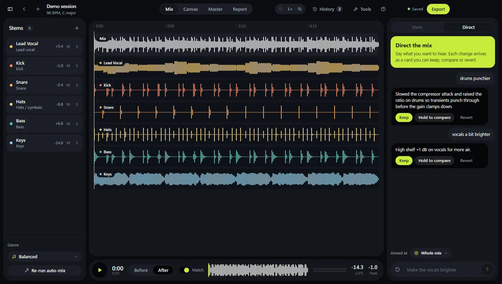
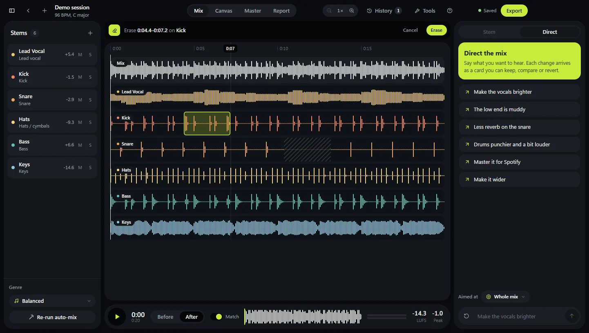
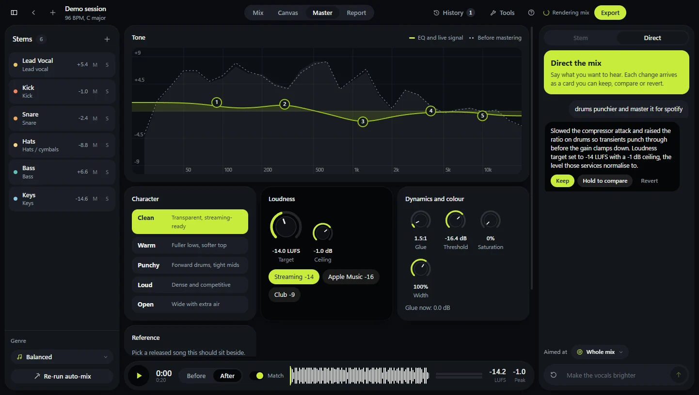

  

<h1 align="center">Stemix.ai</h1>

  <b>Stem mixing and mastering that runs on your own computer.</b> 
  Drop your stems. Get a mix. Upload nothing.

  <a href="https://github.com/stemixteamdev/stemix-releases/releases/latest/download/Stemix-Setup-Windows.exe"><b>⬇ Download for Windows</b></a>
  &nbsp;·&nbsp;
  <a href="https://github.com/stemixteamdev/stemix-releases/releases/latest/download/Stemix-Portable-Windows.exe">Portable app</a>
  &nbsp;·&nbsp;
  <a href="https://stemix-ai.stemixteam.workers.dev/">Website</a>
  &nbsp;·&nbsp;
  <a href="https://github.com/stemixteamdev/stemix-releases/releases">All versions</a>

  

## What it does

Drop in up to 32 stems, or one finished song. Stemix.ai measures every track and sets levels, EQ, compression and loudness from what it hears. Then it masters the result to your target: −14 LUFS for streaming, or louder for clubs.

- **Everything runs on your computer.** No uploads, no account, no cloud queue. Your stems never leave your machine.
- **Mix in plain words.** Type "drums punchier" or "vocals brighter" and hear it straight away. Aim it at the whole mix, a group, or one stem. Each change arrives as a card you can keep, compare or revert.
- **Editing on the timeline.** Line up a late stem by its hits, erase a stray noise, cut a section from the whole song, or combine stems into one.
- **Every step is kept.** History names each change, so you can go back to any point.
- **Mastering to your target.** Shape the tone over the live signal, pick a character, and set the loudness.
- **Projects saved on your computer**, with search (Ctrl K) and a Recently deleted bin that keeps projects for 30 days.

  
  

## Download and install

| Your computer | Download |
|---|---|
| **Windows 10 or 11 (64-bit)** | [Installer](https://github.com/stemixteamdev/stemix-releases/releases/latest/download/Stemix-Setup-Windows.exe) · [Portable app](https://github.com/stemixteamdev/stemix-releases/releases/latest/download/Stemix-Portable-Windows.exe) (runs from any folder, no install) |
| **Mac** | Coming later |

**The first time you open it,** Windows shows "Windows protected your PC", because the app is not yet code-signed. Choose **More info**, then **Run anyway**. You only need to do this once.

**What it needs:** an ordinary laptop or desktop. No graphics card is used. A four-minute stem takes about 85 MB of memory.

**Files it opens:** WAV, MP3, FLAC, M4A, AAC and OGG.

## Get notified of new versions

Click **Watch** at the top of this page, then **Custom → Releases → Apply**. GitHub will email you each time a new version comes out.

## What's new

### 0.2.1
- Smaller, tighter app files.
- Downloads now come from this page.

### 0.2.0
- New home screen, project library with Recently deleted, and Ctrl K search.
- Editing tools: Eraser, Cut, timing with auto-align, and Combine stems.
- History of every change, with one click back to any step.
- Direct can now be aimed at the whole mix, a group or a single stem.
- 14 genres for the automatic mix.
- Light and dark themes.

## Feedback and support

- **Ideas or a problem?** Open an [issue](https://github.com/stemixteamdev/stemix-releases/issues) and tell us what happened.
- **Found a security problem?** Email stemixteam@gmail.com.
- **Privacy:** Stemix.ai collects nothing. Your audio and projects stay on your computer. [Read the privacy page](https://stemix-ai.stemixteam.workers.dev/privacy.html).

---

© 2026 Stemix.ai. All rights reserved. This page hosts the app's downloads only.
